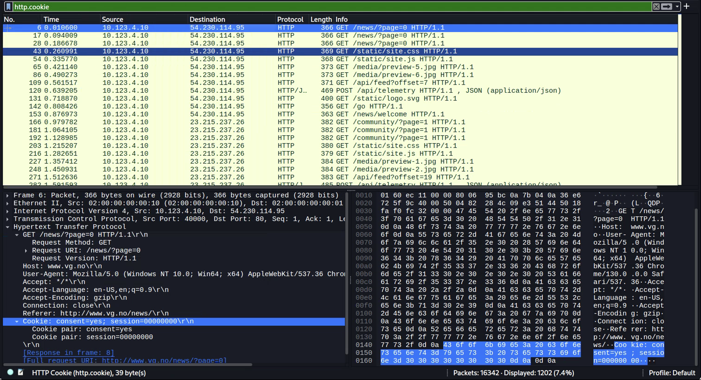
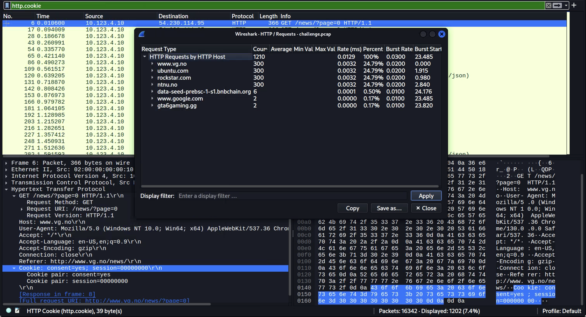

**Task Description:**
How many sessions does the gaming site's analytics cookie indicate? Submit the decimal session count, not the cookie name or the complete cookie.

Do not hash it.
use the same pcap file as in Etherhiding 1

flag format: CTFkom{...}
flag example: CTFkom{100}

**Solution Steps:**
1. Opened the challenge pcap and filtered for `http.cookie` to find HTTP requests containing cookies. 
2. There is requests to multiple URLs, so we have to narrow it down further. From Statistics -> HTTP -> Requests, we can see the requested domains and URLs. `gta6gaming.gg` seems like an interesting choice for further investigation. 
3. Applying the filter `http.cookie and http.host contains "gta6"` to investigate the cookie(s) of the chosen target. Got a cookie pair. `_ga` is supposedly linked to Google Analytics cookies. 
4. In [this](https://www.tink.ca/en/insights/gs1-gs2-silent-transformation-session-cookies-google-analytics-4) article we can read about how these cookies work and how we can parse them.
5. From the cookie `_ga_LAB0000001=GS2.1.s1792231080$o666$g1$t1792231190$j0$l0$h0`, we can see the section `$o666$`. This is the session counter. Thus the amount of sessions are `666`
6. FLAG: `CTFkom{666}`
