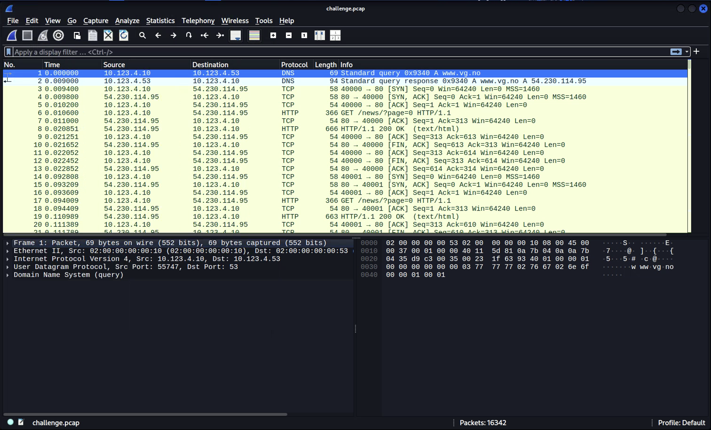
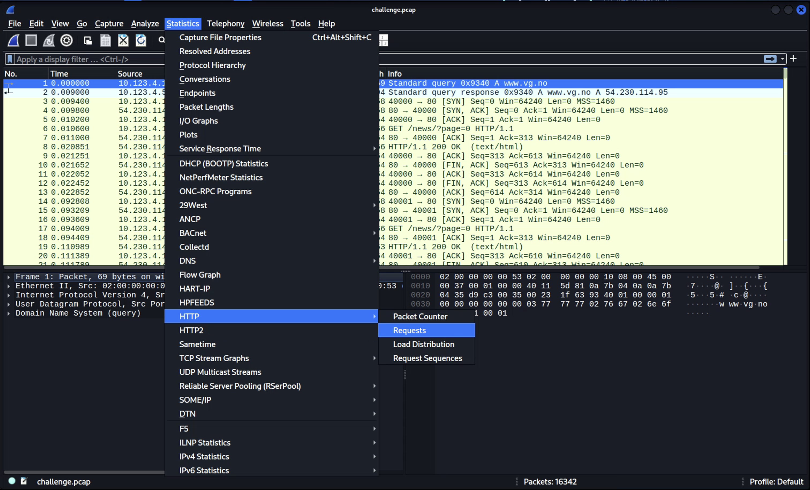
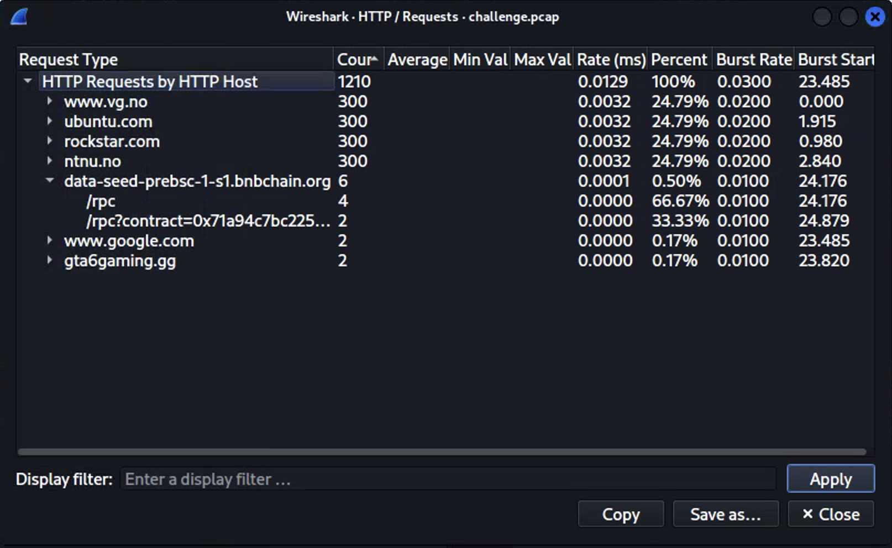
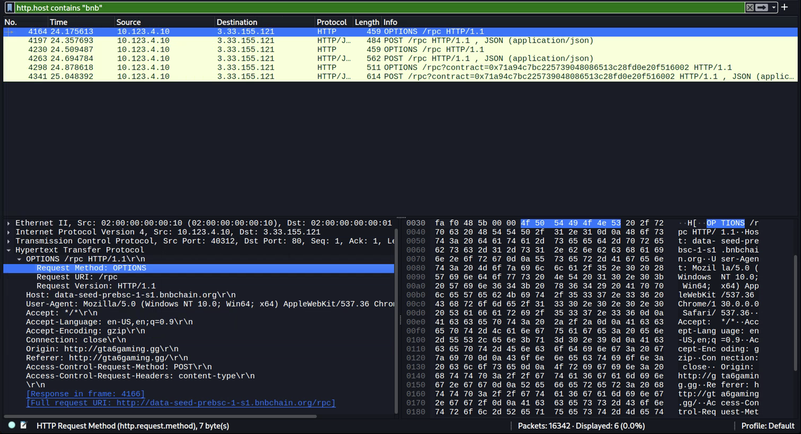

**Task Description:**

**Solution Steps:**
1. Opened the challenge pcap in Wireshark. 
2. Opened Statistics -> HTTP -> Requests to see what HTTP requests has been sent. This is because Etherhiding usually operates over HTTP/HTTPS (Application layer).
3. I noticed that the row containing `bnbchain.org` stands out as the most likely pivot point.
4. The full returned URL was `http://data-seed-prebsc-1-s1.bnbchain.org/rpc`.
5. FLAG: `CTFkom{http://data-seed-prebsc-1-s1.bnbchain.org/rpc}`